# 💈 DluxOS Barbers — Landing Page B2B Oficial

<div align="center">
  
  <h2>Apresentação Comercial & Portal Institucional do DluxOS Barbers</h2>
  <p><strong>HTML5 Semântico • Tailwind CSS • Vanilla JS • Layout Dark Minimalista (#000000) • Zero Dependências Pesadas</strong></p>
</div>

---

## 📖 Visão Geral

A **Landing Page B2B do DluxOS Barbers** é a vitrine comercial oficial da plataforma SaaS. Foi projetada com foco em alta conversão, autoridade editorial, velocidade de carregamento extrema e aderência estética ao design monochrome/dark de alto padrão.

### Destaques Comerciais:
- **Zero Apps & Zero Senhas**: Demonstração do agendamento ágil para clientes finais via link na bio do Instagram.
- **Modelos de Preço Claros**:
  * **Plano Mensal**: R$ 35,00/mês (sem fidelidade ou taxa de cancelamento).
  * **Plano Acesso Vitalício**: R$ 350,00 (pagamento único com futuras atualizações inclusas).
- **Zero Comissões por Corte**: Faturamento 100% da barbearia.

---

## 🗂️ Estrutura de Páginas e Rotas

| Arquivo / Rota | URL Local (Dev) | URL Produção | Descrição |
|:---|:---|:---|:---|
| `index.html` | `http://localhost:5000/` | `https://dluxos.com.br/` | **Landing Page Principal**: Hero banner, prova social, comparativos, planos de preço, FAQ e rodapé institucional. |
| `recursos/index.html`<br>`recursos.html` | `http://localhost:5000/recursos/` | `https://dluxos.com.br/recursos/` | **Especificações Completas**: Detalhamento dos 9 módulos com índice lateral *sticky* numerado e *scroll spy* ativo. |
| `termos/index.html`<br>`termos.html` | `http://localhost:5000/termos/` | `https://dluxos.com.br/termos/` | **Termos de Serviço**: 8 cláusulas contratuais, licença de uso SaaS, SLA de 99,5%, garantia de 7 dias (CDC) e foro. |
| `privacidade/index.html`<br>`privacidade.html` | `http://localhost:5000/privacidade/` | `https://dluxos.com.br/privacidade/` | **Política de Privacidade (LGPD)**: 9 cláusulas em conformidade com a Lei 13.709/18, segurança, criptografia e DPO. |

---

## 🧭 Navegação & Dropdown Inteligente de Recursos

Na barra de navegação superior da Landing Page (`index.html`), o item **"Recursos"** abre um menu *dropdown* escuro em *glassmorphism* que direciona o usuário diretamente para as âncoras na página de especificações:

1. `01` **Agendamento & Vitrine 24h** (`/recursos/#cat-01`)
2. `02` **Controle de Agenda & Pausas** (`/recursos/#cat-02`)
3. `03` **Gestão de Serviços & Preços** (`/recursos/#cat-03`)
4. `04` **WhatsApp & Anti-Ban** (`/recursos/#cat-04`)
5. `05` **Finanças & Comissões** (`/recursos/#cat-05`)
6. `06` **Equipe Multi-Barbeiros** (`/recursos/#cat-06`)
7. `07` **Visual Studio Builder** (`/recursos/#cat-07`)
8. `08` **Base de Clientes (CRM)** (`/recursos/#cat-08`)
9. `09` **Suporte & Segurança** (`/recursos/#cat-09`)

---

## 🚀 Como Executar Localmente

Como a landing page é totalmente estática e auto-contida, ela pode ser servida instantaneamente por qualquer servidor HTTP:

### Opção 1: Python HTTP Server (Recomendado na porta 5000)
```powershell
# Dentro da pasta landpage-barber-saas:
python -m http.server 5000
```
Acesse no navegador: `http://localhost:5000/`

### Opção 2: Node.js / npx serve
```powershell
npx serve -l 5000 .
```

---

## 🌐 Configuração em Produção (Caddy / Nginx)

No servidor de produção (`Caddyfile.production`), as requisições para o domínio raiz comercial (`dluxos.com.br` e `www.dluxos.com.br`) podem ser servidas diretamente como arquivos estáticos ou roteadas para o Next.js na rota `/vendas`:

```caddy
# Exemplo de bloco estático no Caddy:
dluxos.com.br {
    root * /var/www/landpage-barber-saas
    file_server
    try_files {path} {path}/ /index.html
}
```

---

## 🎨 Identidade Visual & Assets

- **Logo Oficial**: `assets/logo/logo.png`
- **Tipografia**: *Plus Jakarta Sans*, *Oswald* e fontes Google Fonts.
- **Paleta de Cores**: Fundo 100% `#000000`, superfícies `#0d0d0f`, bordas sutis `rgba(255,255,255,0.08)`.

---

## 📄 Licença
Propriedade intelectual exclusiva da **DluxOS Barbers**. Todos os direitos reservados.
